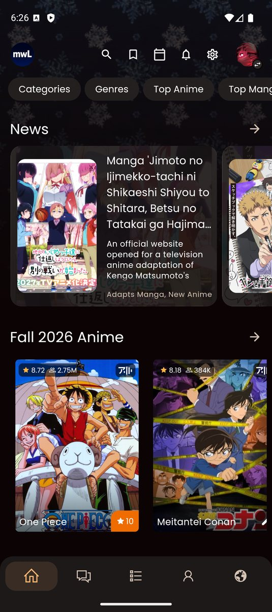
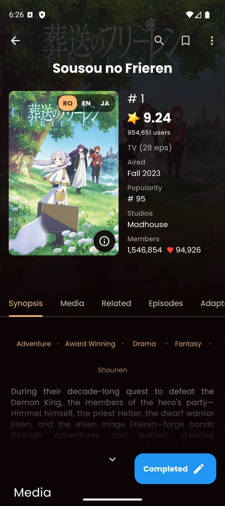
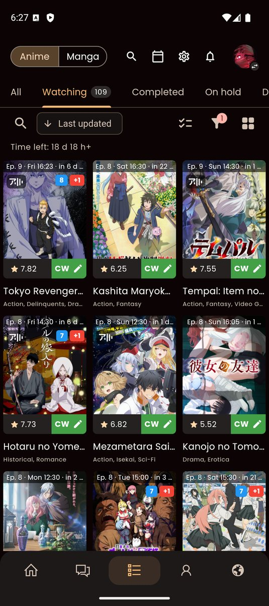
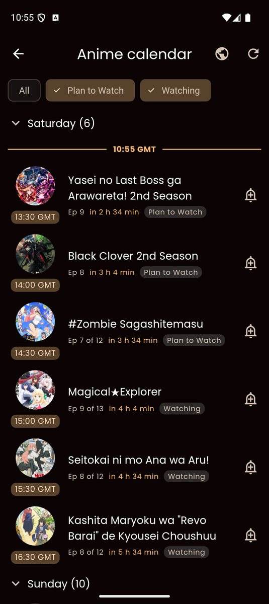
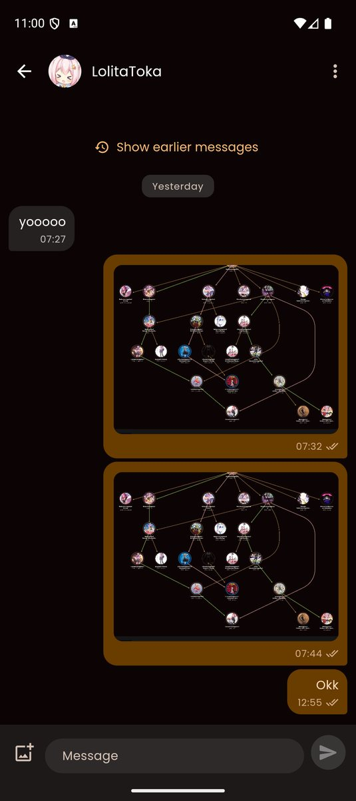
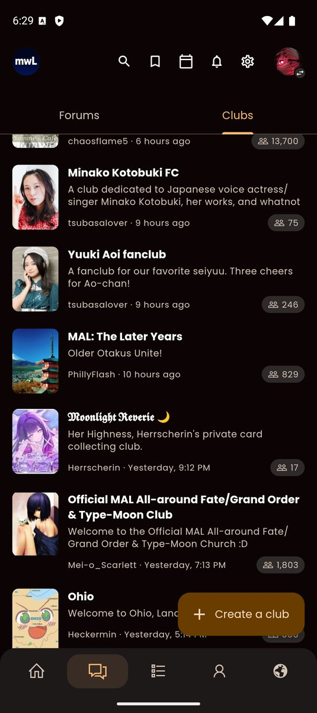
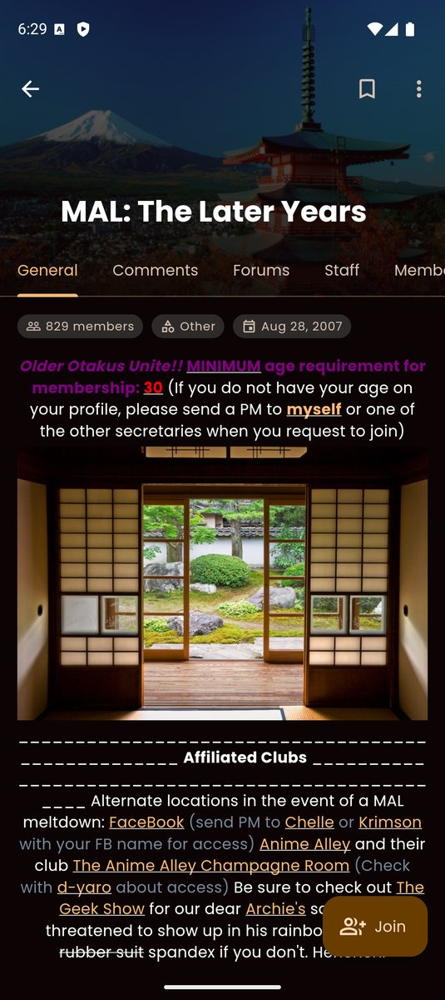
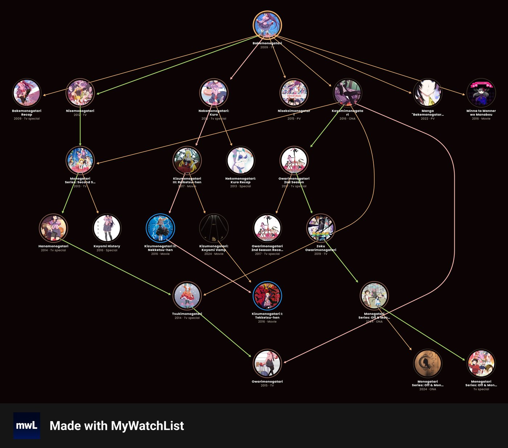

# MyWatchList

A **Flutter** client for **MyAnimeList**, **AniList**, **Kitsu**, and **Simkl** in one app, inspired by [DailyAL](https://github.com/JICA98/DailyAL).
Browse anime, manga, movies, and series, keep your lists up to date, follow your friends, and talk with
the community through forums, clubs, and private messages.

## 🎖️ Features

- **Four trackers in one app**: MyAnimeList, AniList, Kitsu, and Simkl, each with its own screens, plus Jikan for fast MyAnimeList data. Switching account switches the whole app.
- **Anime, manga, movies, and series**: seasonal and upcoming titles, top rankings, all-time favorites, synopses, related titles, recommendations, reviews, and statistics.
- **Your lists**: update a title in a few taps, sort and filter by title, score, start date, or update date, and change, add, or remove several titles at once.
- **Your status everywhere**: every card shows whether a title is in your list, with your status and score, including on other users' lists, with a filter to compare both lists.
- **Relation graph**: a whole franchise drawn as a graph, in release order or from the selected title, saved to the gallery or shared as an image.
- **Private messages like a chat app**: one conversation per person, messages that show at once with delivery ticks, pictures, and nothing lost when a send fails.
- **Notifications**: airing episodes of the anime in your lists, MyAnimeList notifications, new messages, and the titles your friends started, completed, or dropped.
- **Community**: forums, clubs, profiles with badges and statistics charts, and studio pages.
- **Advanced search**: search from the search bar with `@` and `#`, with cached results for fast loading.
- **Themes**: four seasonal dark themes (Spring, Summer, Autumn, and Winter), with more to come.

## 📸 Screenshots

These screens come from a **MyAnimeList** account. AniList, Kitsu, and Simkl have their own screens, built from their own data.

| Home | Anime details | My list |
| :---: | :---: | :---: |
|  |  |  |

| Airing schedule | Messages | Clubs |
| :---: | :---: | :---: |
|  |  |  |

| Club details |
| :---: |
|  |

**Relation graph**, as the app saves it to the gallery

## 🤝 Contributing

Issues and pull requests are welcome. Please do not suggest another state management solution: the
project keeps its Provider and BLoC setup.
